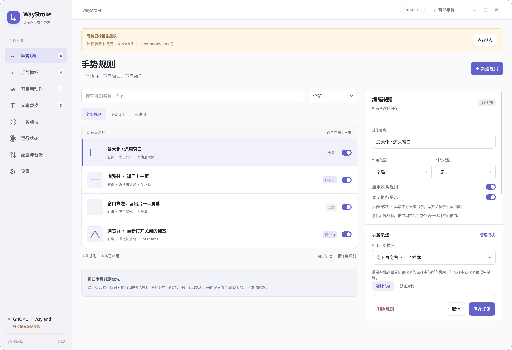
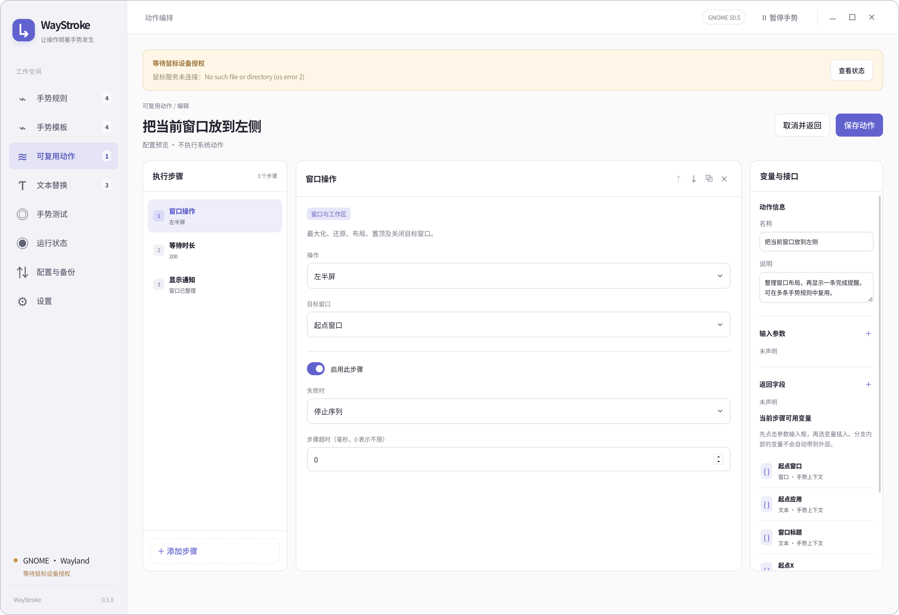
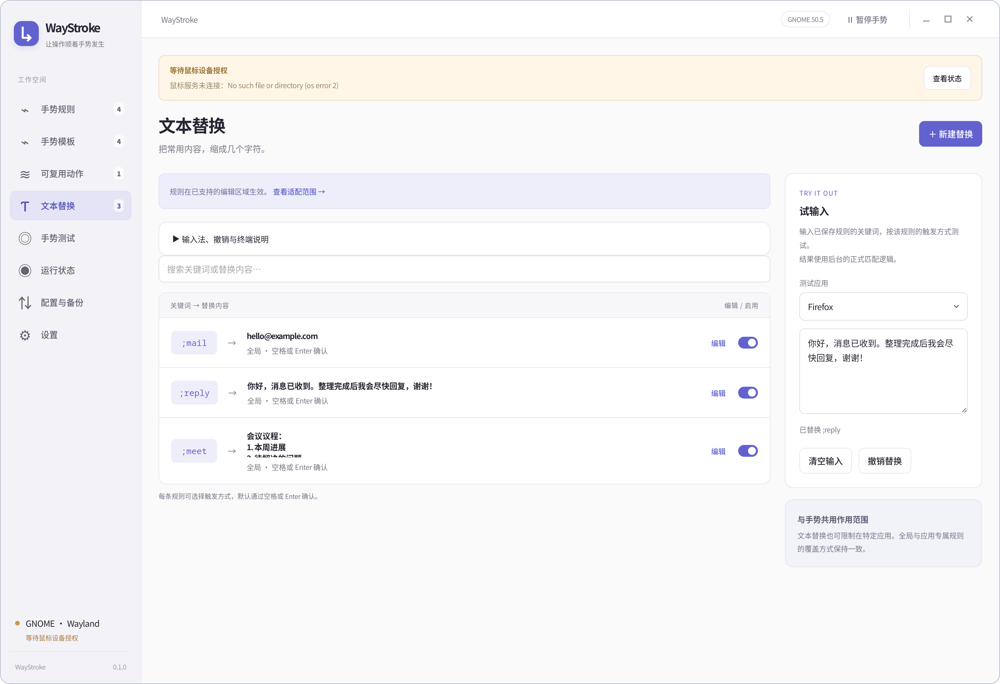

<p align="center">
  
</p>

<h1 align="center">WayStroke</h1>
<p align="center"><strong>让操作顺着手势发生。</strong></p>
<p align="center">为 GNOME Wayland 桌面打造的鼠标手势、动作编排与文本扩展工具。</p>
<p align="center">
  <a href="#开始使用">开始使用</a> ·
  <a href="#不止一个快捷键">动作编排</a> ·
  <a href="#少打几个字多留一点时间">文本替换</a> ·
  <a href="docs/development.md">开发与构建</a>
</p>

按住鼠标右键，画出你习惯的轨迹，再松开。最大化窗口、返回上一页、重新打开标签页，或者执行一组自己的操作，都可以交给一个手势。

**当前支持 Fedora 44 · GNOME Shell / Mutter 50.5 · Wayland · x86_64。** 面向这一明确环境开发与验证，暂不支持其他桌面、X11 会话或其他 GNOME 版本。



*真实应用界面局部，使用独立演示配置。截图中的规则需要自行配置，不是安装后自动启用的预设。*

## 一个手势，按你的习惯工作

- **自由画，而不是记方向组合。** 支持曲线、折线和任意角度；录制自己的轨迹，还能补充多个样本。
- **同一轨迹，不同应用，不同动作。** 全局规则处理通用操作，应用和窗口标题专属规则处理特殊情况。目标以手势开始时指向的窗口为准。
- **边画边知道会发生什么。** 绘制中显示当前匹配的规则名称，支持辅助鼠标按键区分操作；按 Esc 可以取消。
- **先试，再用。** 内置手势测试页，查看相似度、候选规则与匹配原因，不执行系统动作。

你可以从这些小事开始：

| 想做的事 | 可以怎样配置 |
| --- | --- |
| 少找一次窗口按钮 | 画一个折线，切换窗口最大化／还原 |
| 浏览器操作更顺手 | 向左画返回上一页，另一个手势重新打开关闭的标签 |
| 整理工作区 | 把窗口放到左半屏、右半屏，或移到其他工作区 |
| 常用操作一步完成 | 绑定快捷键、启动程序，或引用自己的动作流程 |

这些是配置思路；应用内操作使用对应应用的快捷键，因此也能按你的快捷键习惯调整。

## 不止一个快捷键

把多步操作放进可视化编辑器，按顺序执行，再保存为可复用动作。以后多条手势规则都能引用它，修改时也只需维护一份。



简单流程可以是“窗口靠左 → 等待 → 显示通知”；需要更复杂的操作时，还可以加入条件分支、有限循环、变量、参数和返回值。

配置“发送快捷键”时，可以切换手动输入与按键捕获。点击“开始捕获”，按下组合键并松开全部按键后自动填入；Alt+Tab、Super+Space 等系统组合键也可捕获。Esc、Tab、Enter 可以作为快捷键记录，取消请点击捕获窗口中的按钮。

内置 **10 类、69 项动作**，覆盖键鼠输入、窗口与工作区、应用与命令、剪贴板、文件、系统与媒体、数据处理和流程控制等能力。[查看完整动作目录 →](docs/action-catalog.md)

## 少打几个字，多留一点时间

为常用内容设置关键词：邮箱、常用回复、会议议程，都不必一遍遍输入。支持多行文本，也可以限定只在某个应用中生效。



例如输入 `;reply` 后按空格或 Enter，就能展开为一段完整回复。每条规则可以单独选择空格、Enter、两者确认或立即替换，并设置大小写、关键词前边界和确认字符保留方式。

在替换规则的“作用范围”中选择“所有应用”，或点击“选择应用…”搜索已安装应用、选取当前窗口，也可手动填写应用 ID。同名应用按 ID 区分。外层下拉只保留已配置或主动选择过的候选；“删除此候选”可移除当前候选，也可通过“选择应用…”重新添加。删除候选不会删除已保存规则。右侧“模拟应用”只测试范围匹配，不代表目标应用的输入适配能力。

文本替换与鼠标手势可以分别开关。输入法组合期间不触发替换；提交后按规则处理。GTK、Firefox、Electron、XWayland GTK 的代表性编辑区域，以及 Ptyxis/VTE 的部分终端输入场景已有验证，兼容性仍取决于应用提供的编辑能力。

没有编辑接口的 XWayland 应用（如 Tk、Java Swing）默认使用兼容替换：先用 Shift+← 选中关键词，读回选中的文字与关键词完全一致后才替换，替换时会短暂看到选中效果；密码字段、内容不一致或程序无响应时不编辑。X11 终端不使用兼容替换。某个应用不导出选中文字时，运行状态页会提示并可一键对它停用；也可在“设置 → 应用排除”中勾选“停用兼容替换”。替换期间紧接着按下的键通常会按输入顺序保留，但若它在校验完成前到达，那次替换会放弃并在运行状态中说明。

标题栏提供独立的“暂停文本替换”，与“暂停手势”互不影响。XWayland 应用的编辑接口读取失败或超时时，尚未开始编辑的原确认键会恢复；当前窗口随后暂缓替换，后续空格、回车正常输入，切换窗口或暂停后恢复可重试。没有可靠编辑上下文时，不自动退格删除文字；若编辑请求已发出但结果不明，会停止本次操作并显示失败原因。

> 终端的全屏文本界面（TUI）和原始输入模式不能保证正确替换。当前版本允许终端密码输入参与替换；不需要时请在设置中关闭“终端文本替换”。其他应用的密码字段会跳过。更多边界可在应用内“文本替换 → 查看适配范围”中查看。

## 开始使用

### 安装

当前版本提供 Fedora RPM 打包方式。[GitHub Releases](https://github.com/HANLONG-WANG/WayStroke/releases) 暂无已发布的安装包；需要先按[构建说明](docs/development.md#构建-rpm)生成 RPM，或使用维护者提供的匹配安装包。

在 RPM 所在目录执行（文件名按实际版本替换）：

```bash
sudo dnf install ./waystroke-0.1.0-2.fc44.x86_64.rpm
```

RPM 包含桌面应用、GNOME 扩展和鼠标服务，无需分别安装。安装本身不会选择或接管鼠标。

### 配置第一个手势

1. 从应用菜单打开 **WayStroke**，跟随初次设置向导连接 GNOME 扩展。
2. 授权鼠标接入服务，选择用于手势的鼠标。管理员认证用于鼠标接入服务，设置窗口和动作执行仍以普通用户权限运行。
3. 新建手势规则，录制轨迹，在“窗口匹配”中选择应用及可选标题条件，再设置一个动作，例如“切换最大化”。
4. 保存规则，在“手势测试”中确认匹配结果。
5. 回到目标窗口，按住右键画出轨迹，松开执行。

首次安装后，如果 GNOME 尚未发现扩展，按向导提示注销并重新登录。扩展或原生组件更新后，也需要新桌面会话才能确保加载新版。

新安装使用空配置，你决定启用哪些手势和文本规则。录制时先保持画法自然、稳定，识别不理想时再补充有代表性的样本。

## 日常使用与配置

**关闭设置窗口，后台仍然工作。** 可随时在标题栏暂停手势；要停止整个应用，请使用运行状态页中的“退出 WayStroke”。登录启动可在设置中关闭。

配置支持导入、导出、合并和替换。导入或恢复前自动备份，保留最近 5 份，换机器时也能带走自己的规则。

| 数据 | 默认位置 |
| --- | --- |
| 规则、手势、文本替换和设置 | `~/.config/waystroke/config.json` |
| 自动配置备份 | `~/.local/state/waystroke/backups/` |
| 设置窗口的 WebKit 数据与缓存 | `~/.local/share/io.github.waystroke.Desktop/` |

配置和备份路径遵循对应的 XDG 环境变量。鼠标服务只接管所选鼠标，不通过把用户加入 `input` 组来开放全部输入设备。

### 更新与卸载

保存尚未提交的编辑后，用更高版本的 RPM 升级：

```bash
sudo dnf upgrade ./waystroke-新版本.fc44.x86_64.rpm
```

升级会停止当前组件并替换文件；打开应用可重新启动后台，涉及扩展或原生组件更新时需重新登录。

卸载：

```bash
sudo dnf remove waystroke
```

**正常更新、卸载和重新安装都会保留用户配置与备份。** 卸载会停止组件、移除系统安装文件和鼠标授权；用户目录的 WebKit 数据及登录启动偏好保留。重装后需要重新授权鼠标，保留的登录入口在程序不存在时不会启动它。

## 反馈与开发

使用中遇到问题，可以在 [Issues](https://github.com/HANLONG-WANG/WayStroke/issues) 中提供 Fedora／GNOME 版本、应用名称、复现步骤和预期结果。运行状态页可导出诊断信息；附加配置或截图前，请检查其中是否含有个人内容。

- [开发运行、构建 RPM 与测试](docs/development.md)
- [安装与服务说明](packaging/README.md)
- [完整动作目录](docs/action-catalog.md)
- [产品需求与界面规格](docs/product-design.md)
- [实现与验收记录](docs/implementation-plan.md)

WayStroke 使用 Tauri、Rust 和 GNOME 扩展实现。
